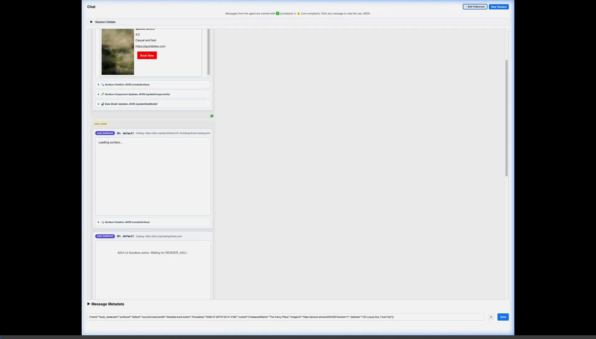

# A2A Inspector (with A2UI Composer Integration)

An inspection and validation tool for **Agent-to-Agent (A2A) protocol** communication, extended to render interactive **A2UI v0.9 protocol surfaces** inside sandboxed iframe containers using **A2UI Composer**.

---

## 🎬 End-to-End Visual UI Demo Video

Below is an interactive video demonstration showing A2A Inspector connected to the official A2UI ADK `restaurant_finder` agent on port `10002` with deduplicated, clean visual A2UI surface card rendering:



---

## 🛠️ Prerequisites & Setup

- **Python 3.10+** & **[UV](https://docs.astral.sh/uv/)**
- **Node.js 20+** & **npm**

---

## 🚀 Running A2A Inspector & ADK Restaurant Finder Agent

### 1. Build A2A Inspector Frontend
```bash
cd frontend
npm install
npm run build
```

### 2. Start A2A Inspector Backend (Port 5001)
```bash
cd backend
uv run --default-index https://pypi.org/simple app.py
```
Access Inspector UI at **[http://127.0.0.1:5001](http://127.0.0.1:5001)**.

### 3. Start A2UI ADK Restaurant Finder Agent (Port 10002)
```bash
# Navigate to the ADK restaurant finder sample directory
cd samples/agent/adk/restaurant_finder  # (in a2ui repo)

# Start the agent server
uv run .
```

---

## 🧪 Testing A2UI in A2A Inspector (End-to-End Checklist)

1. **Connect to Agent**:
   - Open **[http://127.0.0.1:5001](http://127.0.0.1:5001)**.
   - Enter `http://localhost:10002` in the **Agent URL** box and click **Connect**.
   - Verify agent card metadata for *"Restaurant Agent"* appears with `https://a2ui.org/a2a-extension/a2ui/v0.9` capability.

2. **Send Message**:
   - Type `"Find me an Italian restaurant"` and press Enter.

3. **Render A2UI Surface**:
   - Verify single clean A2UI surface card renders inside the sandboxed iframe container without duplicate cards.
   - Expand the 4 JSON inspectors (`createSurface`, `updateComponents`, `updateDataModel`, `deleteSurface`).

4. **Multi-Turn & Surface Updates**:
   - Type `"show me Chinese restaurants instead"` to verify surface model updates in place for `surfaceId="default"`.

5. **User Action Interception**:
   - Click a button (e.g. *"Reserve Table"*) inside a rendered A2UI surface card.
   - Verify that the intercepted `SEND_TO_SERVER` action auto-populates the chat input box and logs in the Debug Console.

---

## 📁 Project Structure

- **[`backend/`](./backend/README.md)**: FastAPI application server, Socket.IO handlers, and proxy endpoints.
- **[`frontend/`](./frontend/README.md)**: Frontend source code, build scripts, and static renderer assets.
  - **[`frontend/src/`](./frontend/src/README.md)**: TypeScript modules (`a2ui-transformer.ts`, `a2ui-surface.ts`, `full-page-chat.ts`).
  - **[`frontend/public/renderer/`](./frontend/public/renderer/README.md)**: Embedded A2UI Composer Lit basic catalog renderer.
